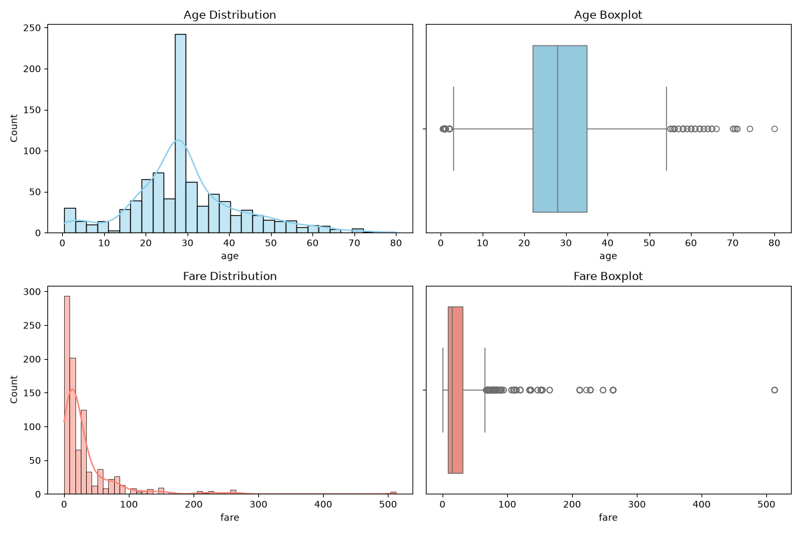
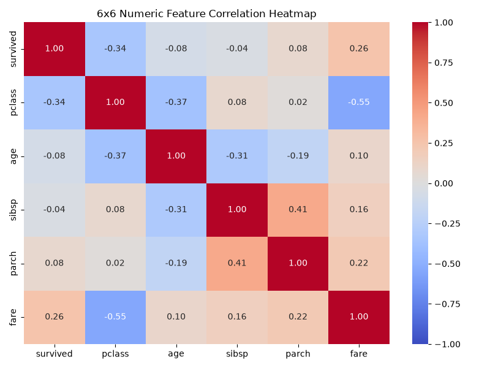
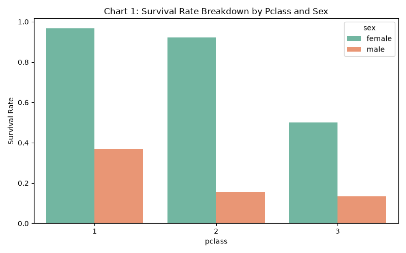
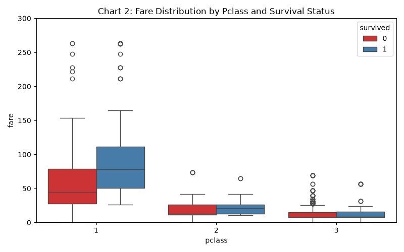
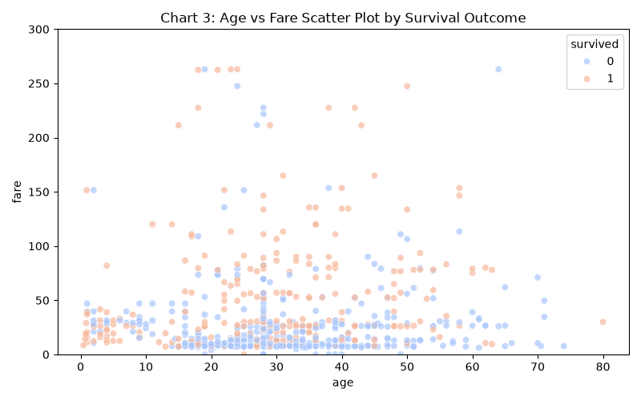
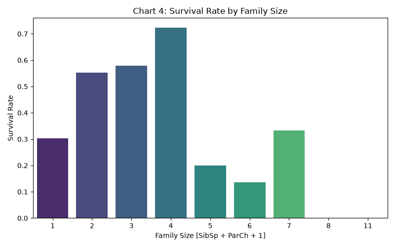
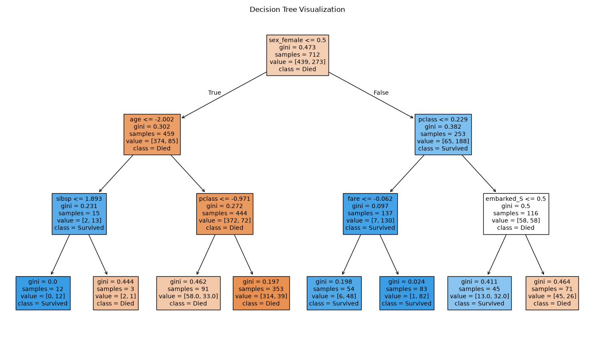
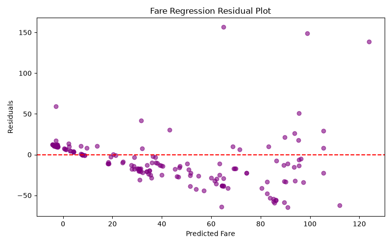

# Zepto Data & AI Platform - Master Execution & Output Summary

This document aggregates all terminal outputs, database query results, machine learning metric comparisons, and generated visualization charts.

## 1. Module 1: Data Pipeline Execution Outputs

```text
=========================================================
                EXECUTING SQL QUERIES                    
=========================================================

1. High-Rated Books with rating >= 4 [SELECT / WHERE]:
                                                                                         title  price_gbp  price_inr  rating
                                                                                 Sharp Objects      47.82    5045.01       4
                                                         Sapiens: A Brief History of Humankind      54.23    5721.26       5
                                            The Dirty Little Secrets of Getting Your Dream Job      33.34    3517.37       4
The Boys in the Boat: Nine Americans and Their Epic Quest for Gold at the 1936 Berlin Olympics      22.60    2384.30       4
                                                                         Shakespeare's Sonnets      20.66    2179.63       4 

2. Most Expensive Books [ORDER BY / LIMIT]:
                                       title  price_gbp  price_inr
The Death of Humanity: and the Case for Life      58.11     6130.6
The Death of Humanity: and the Case for Life      58.11     6130.6
The Death of Humanity: and the Case for Life      58.11     6130.6
The Death of Humanity: and the Case for Life      58.11     6130.6
The Death of Humanity: and the Case for Life      58.11     6130.6 

3. Available Rating Levels [DISTINCT]:
 rating
      1
      2
      3
      4
      5 

4. Mid-Range Price with Rating 4 or 5 [BETWEEN / IN]:
                                                                                         title  price_inr  rating  in_stock
                                            The Dirty Little Secrets of Getting Your Dream Job    3517.37       4         1
The Boys in the Boat: Nine Americans and Their Epic Quest for Gold at the 1936 Berlin Olympics    2384.30       4         1
                                                                         Shakespeare's Sonnets    2179.63       4         1
                                                                     Rip it Up and Start Again    3694.61       5         1
                                                                    Chase Me (Paris Nights #2)    2665.99       5         1 

5. Top Rated Books with Category Name [JOIN]:
                                           title category_name  price_gbp  price_inr  rating
Princess Between Worlds (Wide-Awake Princess #5)       Fantasy      13.34    1407.37       5
Princess Between Worlds (Wide-Awake Princess #5)       Fantasy      13.34    1407.37       5
Princess Between Worlds (Wide-Awake Princess #5)       Fantasy      13.34    1407.37       5
Princess Between Worlds (Wide-Awake Princess #5)       Fantasy      13.34    1407.37       5
Princess Between Worlds (Wide-Awake Princess #5)       Fantasy      13.34    1407.37       5 

=========================================================
        PANDAS pd.merge EQUIVALENCE CHECK               
=========================================================

Pandas pd.merge Output:
                                           title category_name  price_gbp  price_inr  rating
Princess Between Worlds (Wide-Awake Princess #5)       Fantasy      13.34    1407.37       5
Princess Between Worlds (Wide-Awake Princess #5)       Fantasy      13.34    1407.37       5
Princess Between Worlds (Wide-Awake Princess #5)       Fantasy      13.34    1407.37       5
Princess Between Worlds (Wide-Awake Princess #5)       Fantasy      13.34    1407.37       5
Princess Between Worlds (Wide-Awake Princess #5)       Fantasy      13.34    1407.37       5 

Equivalence Verification: Both outputs match exactly -> True

```

## 2. Module 2: Analytics & Predictive Modeling Outputs

### Visual Chart Artifacts

#### Univariate Distributions (Age and Fare)


#### 6x6 Feature Correlation Heatmap


#### Multivariate Story Plots
| Survival by Class and Sex | Fare by Class and Survival |
|---|---|
|  |  |
| Age vs Fare Scatter | Family Size Survival |
|  |  |

#### Decision Tree Plot


#### Fare Regression Residual Plot


### Raw Analytics Statistics and Metrics Log

```text
=========================================================
      TASK 1: DATA LOADING & OFFLINE FALLBACK CREATION   
=========================================================
Dataset loaded successfully. Shape: (891, 15)
Saved offline fallback dataset to 'c:\Users\sampa\CapstoneProject\zepto_data_ai_platform\analytics\titanic.csv'

=========================================================
      TASK 2: PROFILING & MISSING-VALUE ANALYSIS        
=========================================================

--- DataFrame Info ---
<class 'pandas.DataFrame'>
RangeIndex: 891 entries, 0 to 890
Data columns (total 15 columns):
 #   Column       Non-Null Count  Dtype   
---  ------       --------------  -----   
 0   survived     891 non-null    int64   
 1   pclass       891 non-null    int64   
 2   sex          891 non-null    str     
 3   age          714 non-null    float64 
 4   sibsp        891 non-null    int64   
 5   parch        891 non-null    int64   
 6   fare         891 non-null    float64 
 7   embarked     889 non-null    str     
 8   class        891 non-null    category
 9   who          891 non-null    str     
 10  adult_male   891 non-null    bool    
 11  deck         203 non-null    category
 12  embark_town  889 non-null    str     
 13  alive        891 non-null    str     
 14  alone        891 non-null    bool    
dtypes: bool(2), category(2), float64(2), int64(4), str(5)
memory usage: 80.7 KB

--- Summary Statistics ---
         survived      pclass         age       sibsp       parch        fare
count  891.000000  891.000000  714.000000  891.000000  891.000000  891.000000
mean     0.383838    2.308642   29.699118    0.523008    0.381594   32.204208
std      0.486592    0.836071   14.526497    1.102743    0.806057   49.693429
min      0.000000    1.000000    0.420000    0.000000    0.000000    0.000000
25%      0.000000    2.000000   20.125000    0.000000    0.000000    7.910400
50%      0.000000    3.000000   28.000000    0.000000    0.000000   14.454200
75%      1.000000    3.000000   38.000000    1.000000    0.000000   31.000000
max      1.000000    3.000000   80.000000    8.000000    6.000000  512.329200

--- Missing Value Percentages per Affected Column ---
 - age: 19.87% missing
 - embarked: 0.22% missing
 - deck: 77.22% missing
 - embark_town: 0.22% missing

--- Missing Value Strategy Decisions ---
1. deck [77.10% missing > 30% threshold]: Dropped column because missing rate is too high for reliable imputation.
2. age [19.87% missing, within 5% to 30% threshold]: Imputed with median age.
3. embarked & embark_town [0.22% missing < 5% threshold]: Imputed with mode value.

=========================================================
      TASK 3: UNIVARIATE ANALYSIS [AGE & FARE]           
=========================================================

--- AGE Statistics & Outliers ---
Q1: 22.00 | Q3: 35.00 | IQR: 13.00
Outlier Range Bounds: [2.50, 54.50]
Total Outlier Count: 66

--- FARE Statistics & Outliers ---
Q1: 7.91 | Q3: 31.00 | IQR: 23.09
Outlier Range Bounds: [-26.72, 65.63]
Total Outlier Count: 116

--- FARE Central Tendency & Skewness ---
Mean: 32.20 | Median: 14.45 | Mode: 8.05
Ordering: Mean 32.20 > Median 14.45 > Mode 8.05
Distribution Shape: Fare is strongly right-skewed with positive skew.

[SAVED] Univariate chart saved to: c:\Users\sampa\CapstoneProject\zepto_data_ai_platform\analytics\charts\age_fare_distributions.png
=========================================================
      TASK 4: BIVARIATE ANALYSIS & CORRELATION MATRIX    
=========================================================
a. Survival Rate by Sex: Female = 74.20%, Male = 18.89%

b. Survival Rate by Pclass:
 - Pclass 1: 62.96%
 - Pclass 2: 47.28%
 - Pclass 3: 24.24%

c. Survival Rate by Sex and Pclass:
 - Female, Pclass 1: 96.81%
 - Female, Pclass 2: 92.11%
 - Female, Pclass 3: 50.00%
 - Male, Pclass 1: 36.89%
 - Male, Pclass 2: 15.74%
 - Male, Pclass 3: 13.54%

--- 6x6 Numeric Feature Correlation Matrix ---
          survived  pclass    age  sibsp  parch   fare
survived     1.000  -0.338 -0.065 -0.035  0.082  0.257
pclass      -0.338   1.000 -0.340  0.083  0.018 -0.549
age         -0.065  -0.340  1.000 -0.233 -0.172  0.097
sibsp       -0.035   0.083 -0.233  1.000  0.415  0.160
parch        0.082   0.018 -0.172  0.415  1.000  0.216
fare         0.257  -0.549  0.097  0.160  0.216  1.000

[SAVED] Correlation heatmap saved to: c:\Users\sampa\CapstoneProject\zepto_data_ai_platform\analytics\charts\correlation_heatmap.png

--- Top 2 Strongest Off-Diagonal Correlations ---
1. pclass and fare: r = -0.55. Strong negative correlation where 1st class passengers paid substantially higher fares.
2. sibsp and parch: r = +0.41. Moderate positive correlation where passengers traveling with siblings or spouses were often accompanied by parents or children.

=========================================================
      TASK 5: MULTIVARIATE DATA STORY CHARTS             
=========================================================
[SAVED] All 4 multivariate charts saved into: 'c:\Users\sampa\CapstoneProject\zepto_data_ai_platform\analytics\charts'.

=========================================================
      TASK 6: EDA STANDARDIZATION SANITY CHECK          
=========================================================

--- AGE Z-Score Standardization ---
Original Mean: 29.3616 | Original Std: 13.0197
Z-Score Mean : 0.0000 [approximately 0.0]
Z-Score Std  : 1.0000 [approximately 1.0]

--- FARE Z-Score Standardization ---
Original Mean: 32.2042 | Original Std: 49.6934
Z-Score Mean : -0.0000 [approximately 0.0]
Z-Score Std  : 1.0000 [approximately 1.0]

Note: This standardization is strictly an exploratory check and is not leaked into the predictive modeling pipeline.

=========================================================
            TASK 7: STRATIFIED TRAIN/TEST SPLIT          
=========================================================
Train shape: (712, 12) | Test shape: (179, 12)
Train survival mean: 0.3834 | Test survival mean: 0.3855

=========================================================
      TASK 9 & 10: CLASSIFIER TRAINING & EVALUATION      
=========================================================

--- Logistic Regression ---
Accuracy: 0.8045 | Precision: 0.7931 | Recall: 0.6667 | F1: 0.7244 | ROC-AUC: 0.8437
Confusion Matrix:
[[98 12]
 [23 46]]

--- Decision Tree ---
Accuracy: 0.7821 | Precision: 0.8409 | Recall: 0.5362 | F1: 0.6549 | ROC-AUC: 0.8070
Confusion Matrix:
[[103   7]
 [ 32  37]]

--- Random Forest ---
Accuracy: 0.7989 | Precision: 0.7797 | Recall: 0.6667 | F1: 0.7188 | ROC-AUC: 0.8294
Confusion Matrix:
[[97 13]
 [23 46]]

[SAVED] Decision tree chart saved to 'c:\Users\sampa\CapstoneProject\zepto_data_ai_platform\analytics\charts/decision_tree.png'.

=========================================================
        TASK 11: CLASS IMBALANCE STRATEGY COMPARISON      
=========================================================
Imbalance Handling Results:
1. Baseline       -> Precision: 0.7797, Recall: 0.6667, F1: 0.7188
2. Class Balanced -> Precision: 0.7463, Recall: 0.7246, F1: 0.7353
3. SMOTE on Train -> Precision: 0.7576, Recall: 0.7246, F1: 0.7407

=========================================================
      TASK 12: GRIDSEARCHCV & OOB SCORE EVALUATION       
=========================================================
Best Parameters: {'classifier__max_depth': 4, 'classifier__max_features': 'sqrt', 'classifier__n_estimators': 100}
Best 5-Fold Cross-Validation F1 Score: 0.7455
Out-of-Bag Score: 0.8188

[SAVED] Complete pipeline artifact saved to: 'c:\Users\sampa\CapstoneProject\zepto_data_ai_platform\analytics\models\full_zepto_titanic_pipeline.pkl'.

=========================================================
        TASK 13: REGRESSION SIDE-TASK - PREDICT FARE     
=========================================================
Regression Metrics: MAE = 20.81 | RMSE = 30.47 | R2 = 0.3999 | Adj R2 = 0.3604

[REPORT GENERATED] Visual Markdown summary saved at: c:\Users\sampa\CapstoneProject\zepto_data_ai_platform\analytics\outputs\analytics_report.md

```

## 3. Module 3: GenAI Support Assistant Outputs

```json
[
  {
    "query": "What is the delivery fee for orders below INR 149?",
    "intent": "policy_question",
    "response": {
      "answer": "Based on the retrieved context: Zepto delivers grocery and household essentials to serviceable pin codes within 10 to 30 minutes of order confirmation, depending on the customer's delivery zone and current order volume. Standard del",
      "sources": [
        "doc_01",
        "doc_05"
      ],
      "confidence": 1.0
    }
  },
  {
    "query": "What is the capital of India?",
    "intent": "general_question",
    "response": {
      "answer": "I can only answer questions about Zepto policies right now.",
      "sources": [],
      "confidence": 1.0
    }
  }
]
```

